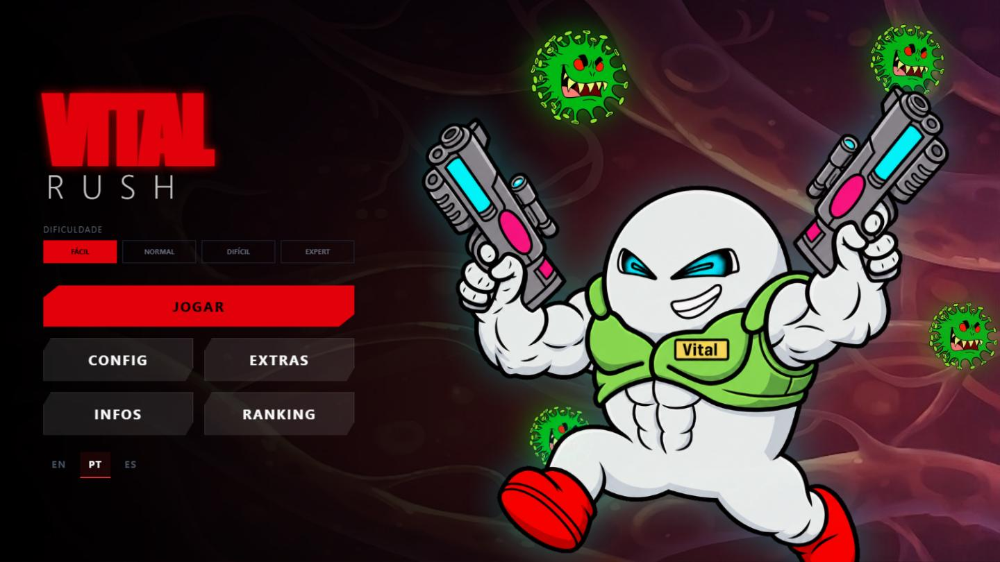
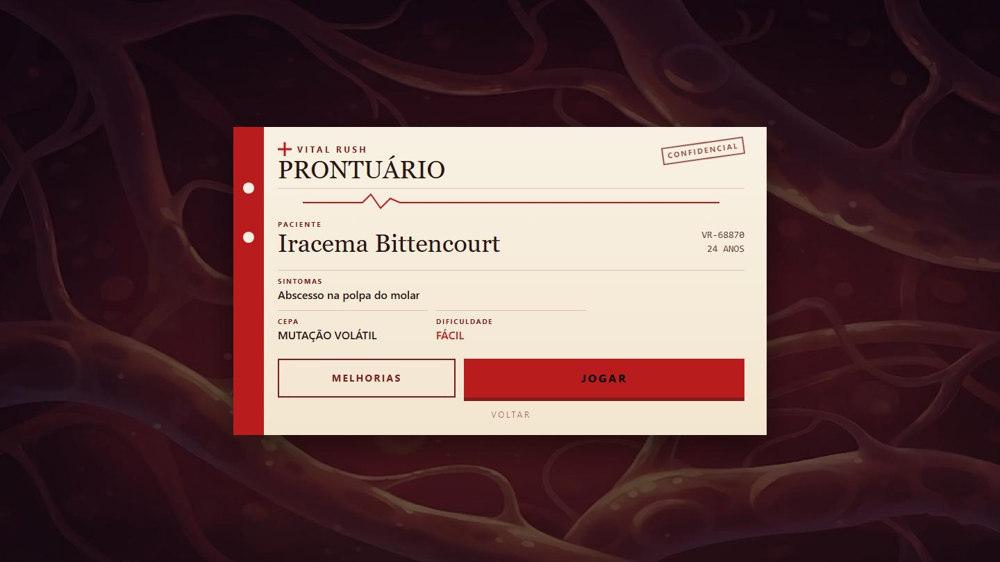
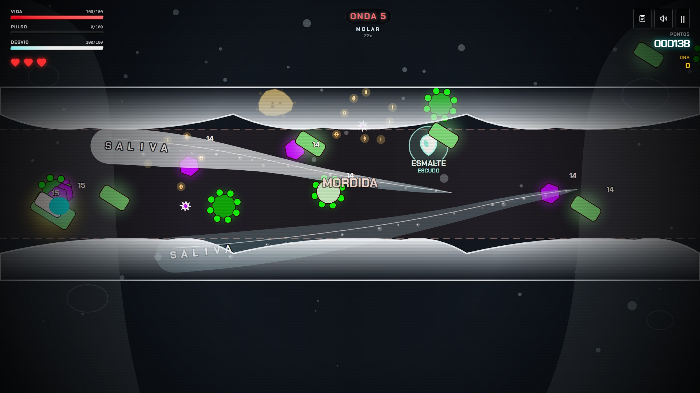
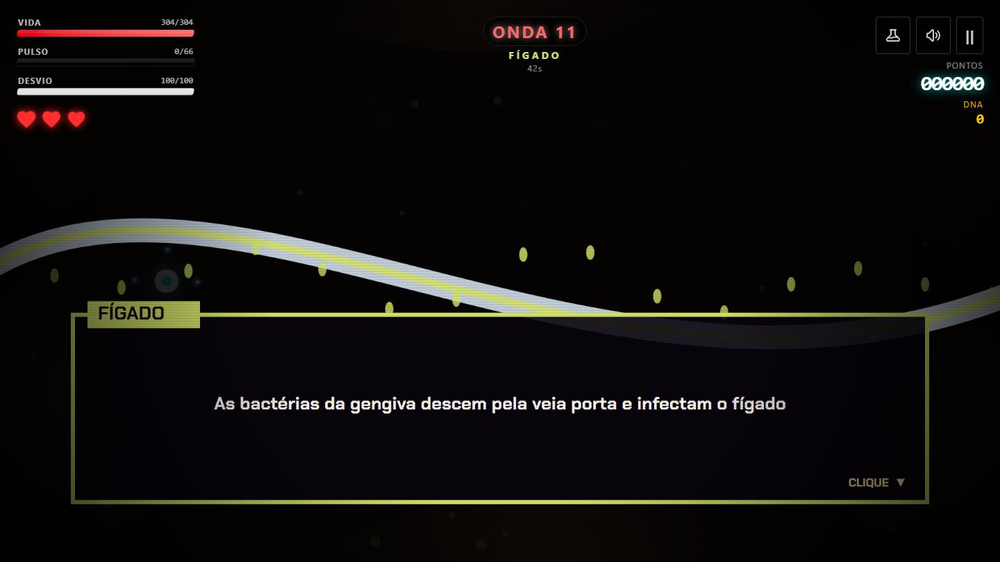
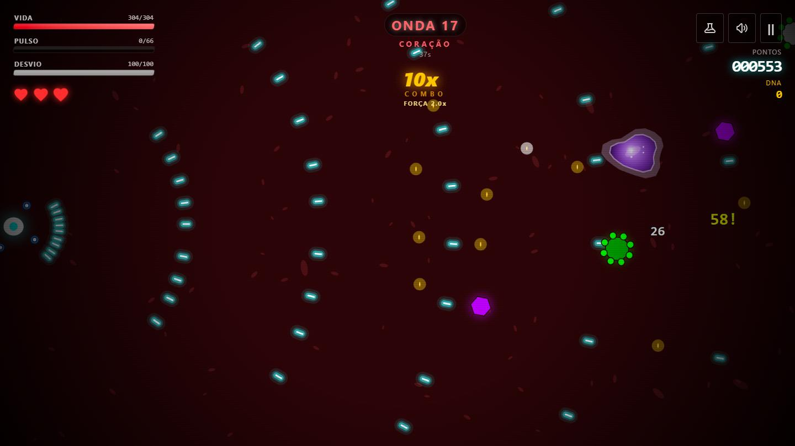
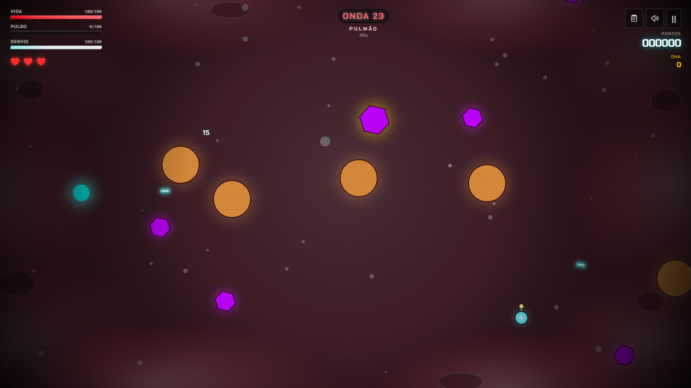
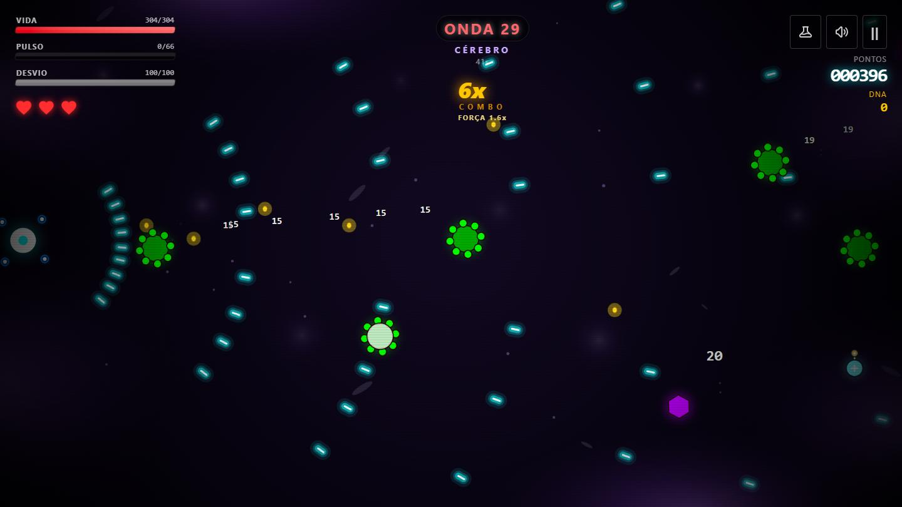
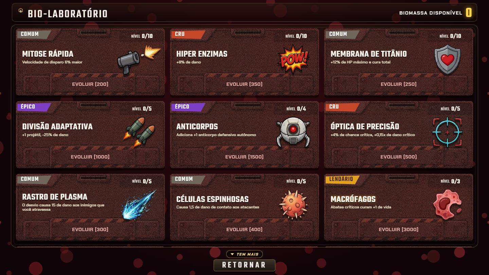

# VITAL RUSH

O corpo abriu um chamado. O reforço que chegou foi uma célula. Você é o Vital, de plantão por dentro do paciente: o prontuário diz o nome na porta, a infecção escolhe a sala, e o turno atravessa molar, fígado, coração, pulmão e cérebro. Trinta ondas para fechar a ficha. Se o expediente cair no meio, o carimbo sai de paciente perdido.



STYH Games. Direção de Paulo Gabriel de L. S.

## O plantão

- Cinco órgãos no roteiro: molar, fígado, coração, pulmão e cérebro, divididos em trinta ondas.
- A ordem sai no sorteio a cada ficha: são 120 caminhos possíveis, e cada combinação é uma doença diferente.
- O prontuário entrega na largada o nome, a idade e o foco inicial do paciente. Nesta ficha, o plantão caiu na Iracema.



- No molar, uma faixa avisa antes de as paredes fecharem na mordida. O estrago é quando os dentes se encontram; ficar no meio é erro de cálculo.



- Na troca de um órgão para o outro, o expediente dá uma pausa rápida e explica por que a infecção foi parar naquela sala.



- Cada órgão muda de cor e de encrenca fisiológica conforme a viagem avança por coração, pulmão e cérebro.






## Bio-laboratório e combate

- As moedas de DNA que caem no chão pagam a conta no bio-laboratório: mitose, membrana, anticorpo e o resto do receituário. O chão solta um pouco mais, e são mais moedas para catar. No começo da ficha o saldo vem zerado, e a carta que você ainda não pode pagar fica na vitrine só para lembrar da falta de verba.



- O expediente normal traz bactéria, vírus, fungo e parasita. O passo de cada um continua o mesmo, mas elas não chegam todas pela mesma reta: a bactéria fecha por cima e por baixo, o fungo corta o zigue-zague em alturas diferentes, o vírus segura uma faixa e cospe o espinho na frente do passo, o parasita quase não recua e tampa a saída. Um chefe fecha a porta na última onda de cada órgão.
- São três vidas na ficha. Perder uma não trava o plantão: a tela leva um corte, o coração da ficha racha na hora, e o corpo segue. O desvio deixa você intocável por um piscar de olhos e atravessa o tiro inimigo, e o pulso empurra quem encosta enquanto puxa as moedas de DNA.
- Quatro dificuldades na triagem: Fácil, Normal, Difícil e Expert. O Normal de hoje é o Expert de antes; o Fácil existe para conhecer o corredor sem apanhar na recepção.
- Atendimento em português, inglês e espanhol.
- No teclado, setas ou WASD movem, Shift aciona o desvio e espaço solta o pulso. No celular, o manche aparece sozinho ao tocar e a tela trava deitada.

## Rodar

- Precisa de Node.js.

```
npm install
npm run dev
```

- Abre em `http://localhost:5173`. `npm run build` gera a pasta `dist`. A casca de Android está em `android`, com Capacitor.
